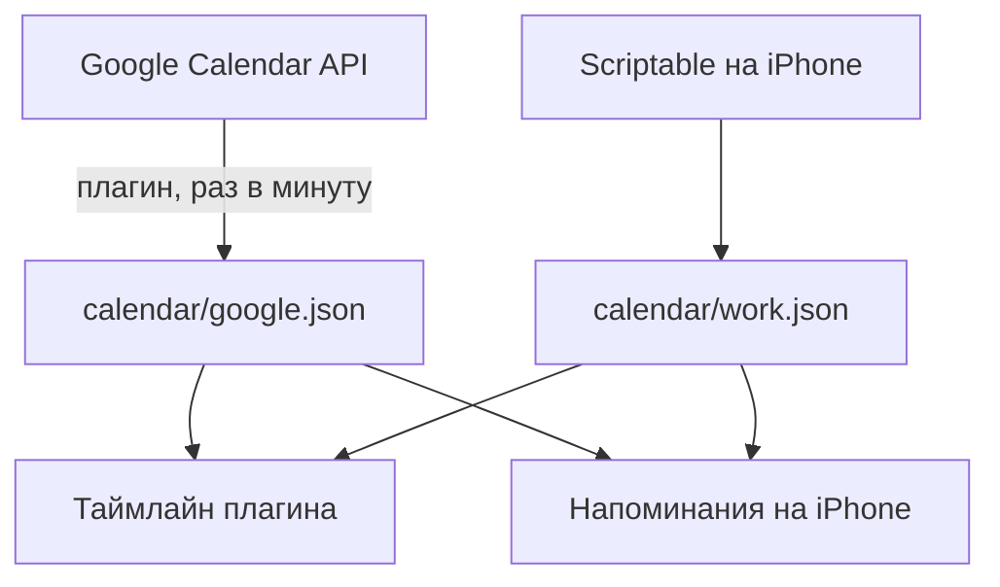

# Календари

Таймлайн показывает встречи из двух источников. Плагин их только читает: события нельзя двигать, создавать или менять.

## Где лежат встречи

Встречи каждого источника лежат в своём файле в волте, и только там. Таймлайн плагина и напоминания на iPhone читают эти файлы и больше ничего. Источники только пишут в них.

| Файл | Кто пишет | Когда | Настройка |
|---|---|---|---|
| `calendar/google.json` | плагин, из Google Calendar API, на каждом устройстве, где открыт календарь | при открытии вида и смене дня, раз в минуту (Refresh interval), при возвращении в Obsidian | [Google Calendar](../../README.md#google-calendar) |
| `calendar/work.json` | Scriptable на iPhone, из всех календарей телефона (Exchange и др.) | автоматизации «Команд» при открытии Obsidian и каждый час днём; кнопка Refresh now | [Рабочий календарь на iPhone](work-calendar.md) |

- В `google.json` встречи за месяц назад и на три месяца вперёд. Дальше этого окна Google-встреч на таймлайне нет, у рабочего файла окно своё: со вчера на две недели вперёд.
- Файл Google переписывается, только когда встречи изменились, и раз в 10 минут, чтобы показать, что он свежий. Плагин сравнивает новое с тем, что уже в файле.
- Если Google не ответил, в файле остаются прежние встречи, таймлайн их показывает, а в окне источников видна ошибка. После выхода из Google файл пустеет.
- Оба файла — обычные JSON одного формата. Их можно открыть и посмотреть, но правят их только источники.

- Вход в Google один на все устройства: токен лежит в `data.json` плагина и приезжает через Obsidian Sync.
- Mac рабочие события не выгружает: тот же `work.json` приходит с телефона через Sync (включи в Sync «другие типы файлов»). `google.json` каждое устройство пишет само.
- Встречи, от которых отказался, в рабочий файл не попадают.
- Если рабочие встречи есть и в Google, в настройках More → Calendars → Work calendar → Calendar titles перечисляют, какие календари брать из файла, — иначе они покажутся дважды.
- Цвет события — цвет его календаря. Прошедшие события блекнут.

## Окно источников

Долгое нажатие на колёсико, когда открыт календарь. По строке на источник: когда обновлялся («Updated today», «Exported from iPhone») и время; оранжевое время — источник устарел, ошибка — её текст. Внизу **Refresh now**: обновляет оба источника. «Updated» у Google — когда плагин последний раз записал её файл. На iPhone он на мгновение открывает «Команды», чтобы запустить выгрузку рабочего календаря, и сразу возвращает в Obsidian.

Оранжевая точка на иконке календаря в колёсике — источник не обновлялся дольше Stale after (по умолчанию 3 часа) или вернул ошибку.

## Меню события

Тап по событию открывает его меню с одной строкой **Open in Calendar**: Календарь Apple на этом событии (на iPhone — на времени начала, на Mac — на дне, с поиском и выделением события).

## Напоминания

Сами календари не напоминают о задачах. Задача со временем звонит на iPhone через отдельное приложение Task Calendar для iOS — см. [Напоминания на iPhone](notifications.md).
