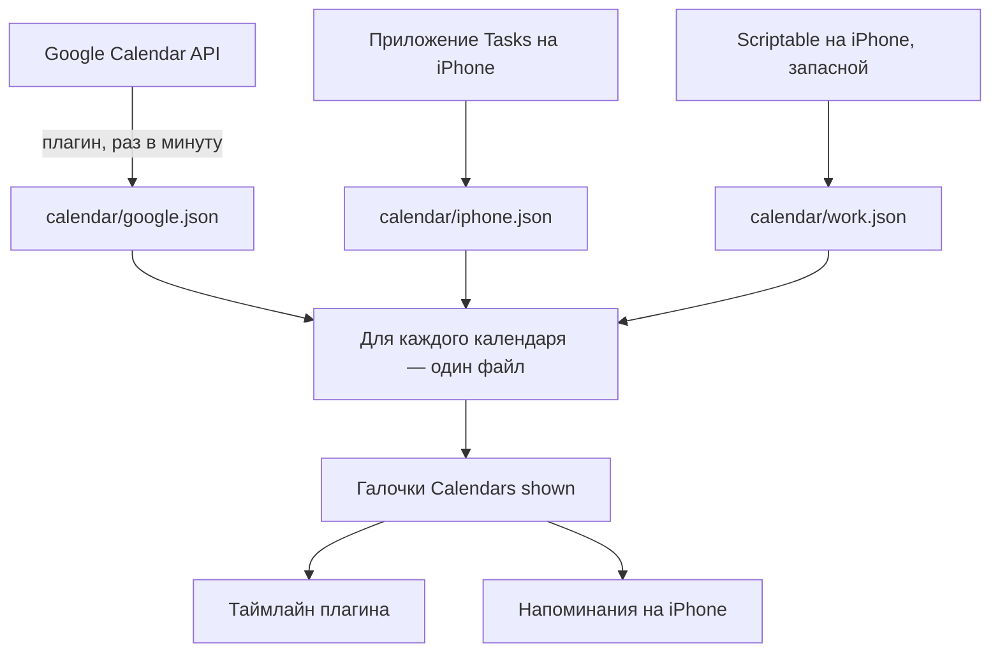

# Календари

Таймлайн показывает встречи календарей Google, рабочего (Exchange) и остальных календарей iPhone. Плагин их только читает: события нельзя двигать, создавать или менять.

## Где лежат встречи

Встречи лежат в файлах в волте, и только там. У каждого источника свой файл, туда он пишет все календари, которые видит. Таймлайн плагина и напоминания на iPhone читают эти файлы и больше ничего.

| Файл | Кто пишет | Когда |
|---|---|---|
| `calendar/google.json` | плагин, из Google Calendar API, на каждом устройстве, где открыт календарь | при открытии вида и смене дня, раз в минуту (Refresh interval), при возвращении в Obsidian |
| `calendar/iphone.json` | приложение Tasks на iPhone, из всех календарей телефона (Exchange, Google, если аккаунт добавлен в iPhone, iCloud) | каждый раз, когда приложение обновляет напоминания: при выходе из Obsidian и при его открытии (автоматизации «Команд»), при кнопках уведомлений, в фоне; по Refresh now |
| `calendar/work.json` | Scriptable на iPhone, из всех календарей телефона — запасной путь, если приложение не работает | автоматизации «Команд»; Refresh now, когда приложение не может ([Рабочий календарь на iPhone](work-calendar.md)) |

## Какой файл берётся

Каждый календарь берётся целиком из одного файла, встречи одного календаря из разных файлов не смешиваются. Порядок:

- календари Google-аккаунта: Google API → приложение → Scriptable;
- остальные: приложение → Scriptable.

Берётся первый файл по порядку, в котором есть этот календарь, который покрывает этот день и который свежий — записан не дольше Stale after назад (3 часа). Если свежих нет — самый свежий из них. Так запасные источники подхватывают сами: просрочилось приложение — рабочий календарь берётся из Scriptable; Google API не отвечает — календари Google берутся из приложения.

- Окно файлов: `google.json` и `iphone.json` — месяц назад и три месяца вперёд, `work.json` — со вчера на две недели.
- Один календарь в разных файлах узнаётся по аккаунту и названию. Аккаунт Google на iPhone узнаётся по названиям календарей: это аккаунт, у которого больше всего календарей с теми же названиями, что у Google. Как iPhone назвал сам аккаунт («Gmail» или иначе) и как называется главный календарь, неважно.
- Встречи, от которых отказался, и отменённые в файлы приложения и Scriptable не попадают.
- Цвет события — цвет его календаря в том файле, откуда он взят. Прошедшие события блекнут.
- Вход в Google один на все устройства: токен лежит в `data.json` плагина и приезжает через Obsidian Sync. После выхода из Google его файл пустеет.
- `iphone.json` и `work.json` пишет только телефон: на Mac они приходят через Sync (включи в Sync «другие типы файлов»). `google.json` каждое устройство пишет само.

## Какие календари видны

Settings → Tasks → More → Calendars → **Calendars shown**: все календари из всех файлов, по аккаунтам, с переключателем у каждого. Новый календарь сразу виден. Выбор не зависит от того, что включено в Apple Calendar или в Google. Тот же выбор действует для напоминаний на iPhone.

## Окно источников

Долгое нажатие на колёсико, когда открыт календарь. По строке на файл: Google Calendar, iPhone calendars, Work calendar — когда обновлялся («Updated today», «Exported from iPhone») и время; оранжевое время — файл устарел, ошибка — её текст. Внизу **Refresh now**: заново спрашивает Google и обновляет календари телефона. На iPhone он на мгновение открывает приложение Tasks, оно записывает календари телефона и возвращает в Obsidian. Если подпись приложения истекла или оно вернулось, ничего не записав, вместо него на мгновение открываются «Команды» с выгрузкой Scriptable.

Оранжевая точка на иконке календаря в колёсике — какой-то календарь на экране взят из несвежего файла. Значит, всё, что могло обновиться само, не обновилось: жми Refresh now.

## Меню события

Тап по событию открывает его меню с одной строкой **Open in Calendar**: Календарь Apple на этом событии (на iPhone — на времени начала, на Mac — на дне, с поиском и выделением события).

## Напоминания

Сами календари не напоминают о задачах. Задача со временем звонит на iPhone через отдельное приложение Tasks для iOS — см. [Напоминания на iPhone](notifications.md).
